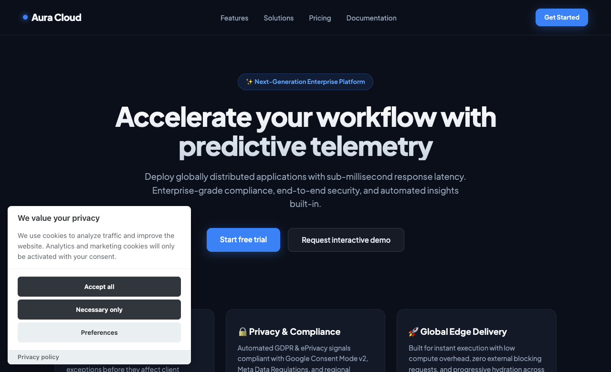
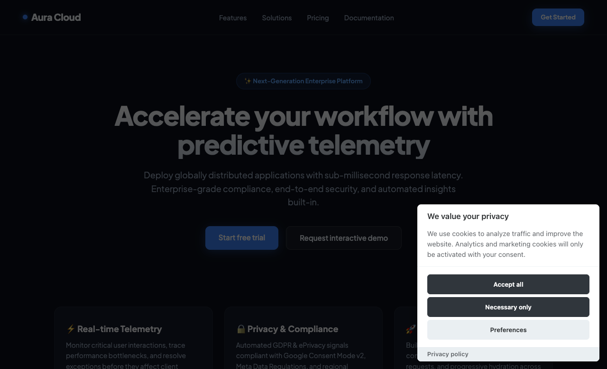
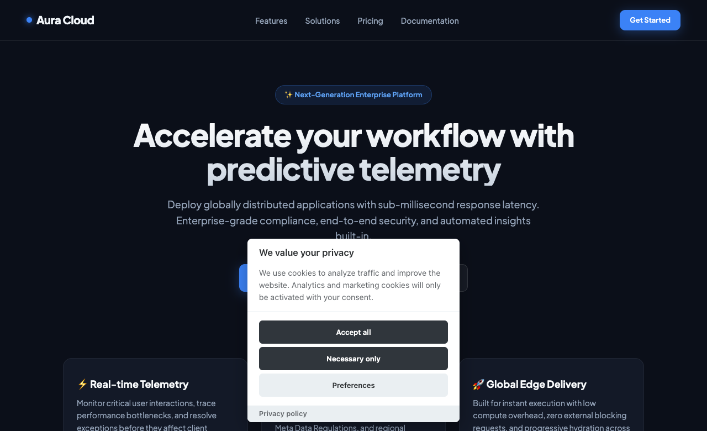
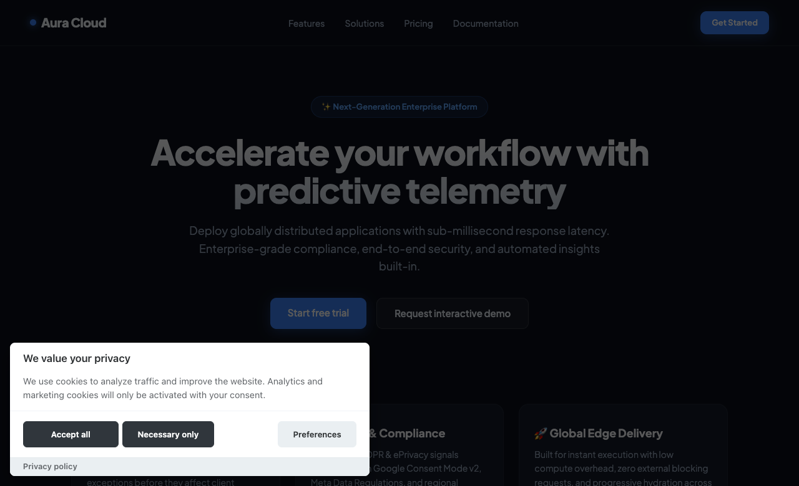
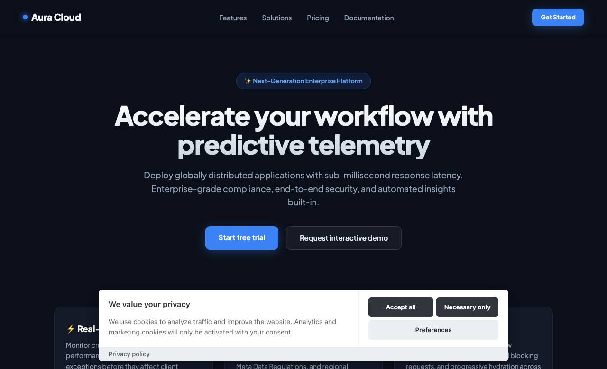
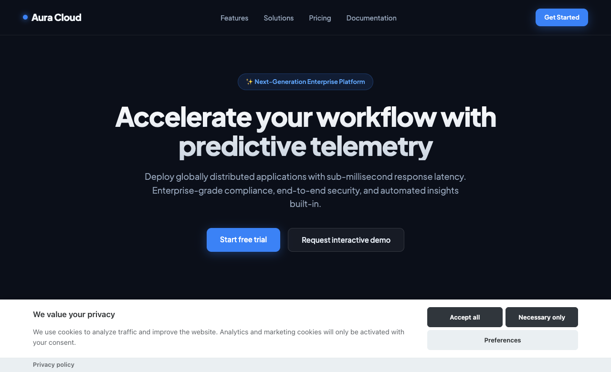
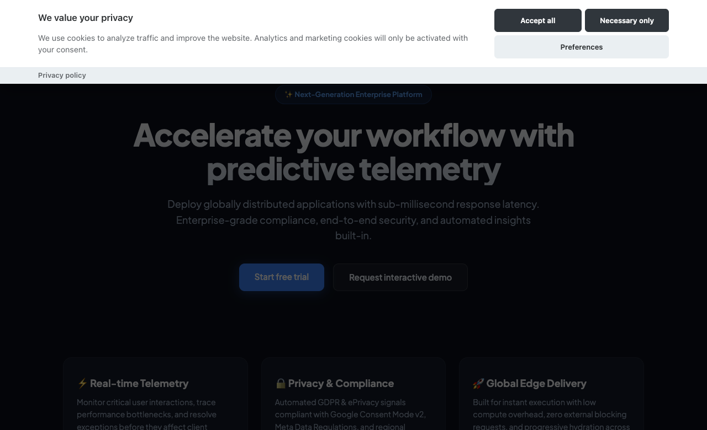
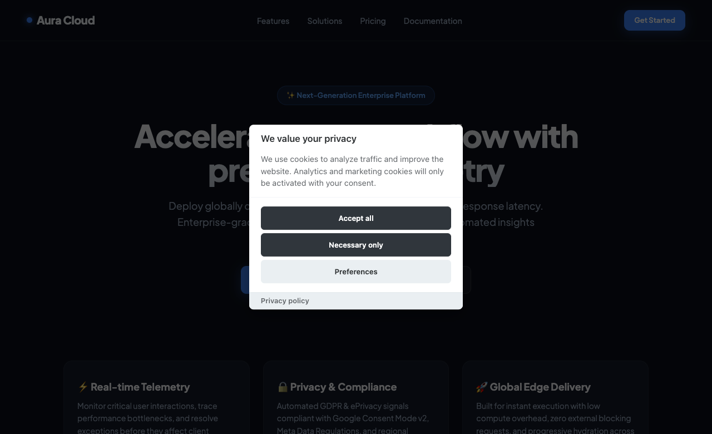
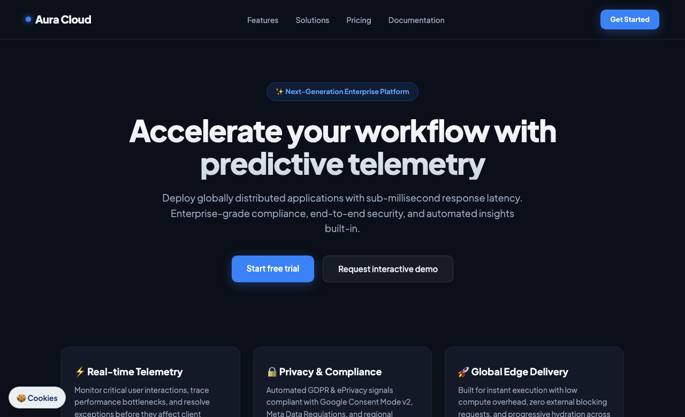

# @krysmalskipl/astro-consent-mode

Google Consent Mode v2 for Astro - cookie banner, GTM, GA4, Meta Pixel and Microsoft Clarity with zero config.

## Features

- **Google Consent Mode v2**: Full support for `ad_storage`, `ad_user_data`, `ad_personalization`, and `analytics_storage`.
- **Integrated Cookie Banner**: Powered by vanilla-cookieconsent v3 with an accessible and customizable UI.
- **Multi-Service Loaders**: First-class support for Google Tag Manager, Google Analytics 4, Meta Pixel (Facebook Pixel), and Microsoft Clarity.
- **Microsoft Clarity Consent API v2**: Implements `clarity('consentv2', ...)` for proper European Economic Area compliance.
- **Two Consent Modes**: Choose between `basic` (strict tag blocking until consent) and `advanced` (cookieless pings with default denied).
- **Synchronous Returning Visitor Handling**: Reads consent synchronously in `<head>` to prevent tagging delays on subsequent page visits.
- **Auto Cookie Cleanup**: Removes tracking cookies (`_ga`, `_fbp`, `_clck`, etc.) when consent is withdrawn.
- **Bilingual by Default**: Built-in Polish (`pl`) and English (`en`) translations with deep customization.
- **Fully Typed**: Includes comprehensive TypeScript definitions and JSDoc documentation.

## Installation

Add the integration to your Astro project:

```bash
npx astro add @krysmalskipl/astro-consent-mode
```

Or install manually via npm:

```bash
npm install @krysmalskipl/astro-consent-mode vanilla-cookieconsent
```

Then register the integration in your `astro.config.mjs`:

```javascript
import { defineConfig } from 'astro/config';
import consent from '@krysmalskipl/astro-consent-mode';

export default defineConfig({
  integrations: [
    consent({
      gtmId: 'GTM-XXXXXX',
    }),
  ],
});
```

## Usage

```javascript
import { defineConfig } from 'astro/config';
import consent from '@krysmalskipl/astro-consent-mode';

export default defineConfig({
  integrations: [
    consent({
      // Tracking IDs
      gtmId: 'GTM-XXXXXX',        // Optional: Google Tag Manager ID
      ga4Id: 'G-XXXXXXXXXX',      // Optional: Used if gtmId is omitted
      metaPixelId: '1234567890',  // Optional: Meta Pixel ID
      clarityId: 'abcdef1234',    // Optional: Microsoft Clarity ID

      // Strategy and Language
      mode: 'basic',              // 'basic' | 'advanced' (default: 'basic')
      lang: 'pl',                 // 'pl' | 'en' (default: 'pl')
      privacyUrl: '/polityka-prywatnosci/', // Link to Privacy Policy

      // Revisions & Customizations
      revision: 0,                // Increment to force re-consent
      texts: {                    // Custom text overrides
        consentModal: {
          title: 'Dbamy o Twoją prywatność',
        },
      },
      gui: {
        consentModal: {
          layout: 'box',
          position: 'bottom left',
        },
      },
    }),
  ],
});
```

## Options

| Option | Type | Default | Description |
| --- | --- | --- | --- |
| `gtmId` | `string` | `undefined` | Google Tag Manager ID (e.g. `'GTM-XXXXXX'`). Takes precedence over `ga4Id`. |
| `ga4Id` | `string` | `undefined` | Google Analytics 4 Measurement ID (e.g. `'G-XXXXXX'`). |
| `metaPixelId` | `string` | `undefined` | Meta Pixel ID (numeric string, e.g. `'1234567890'`). |
| `clarityId` | `string` | `undefined` | Microsoft Clarity Project ID (alphanumeric string). |
| `mode` | `'basic' \| 'advanced'` | `'basic'` | Tag loading strategy. In `basic`, tags are blocked until consent. In `advanced`, Google and Clarity load immediately with default `denied`. |
| `lang` | `'pl' \| 'en'` | `'pl'` | Default language for cookie consent modal. |
| `privacyUrl` | `string` | `'/polityka-prywatnosci/'` (pl) or `'/privacy-policy/'` (en) | Target URL for privacy policy link. |
| `texts` | `object` | `undefined` | DeepPartial object overriding default modal translations. |
| `banner` | `string` | `'box-left'` | Banner layout preset - see [Banner layouts](#banner-layouts). |
| `overlay` | `boolean` | `true` for `'modal'`, otherwise `false` | Dim the page and block interaction until the visitor decides. |
| `gui` | `object` | `{}` | Low-level vanilla-cookieconsent `guiOptions`, merged on top of the `banner` preset. |
| `revision` | `number` | `0` | Revision counter. Incrementing invalidates stored cookies and re-prompts visitors. |
| `urlPassthrough` | `boolean` | `true` | Enables `url_passthrough` in Google tag to retain ad click info across pages without cookies. |
| `adsDataRedaction` | `boolean` | `true` | Enables `ads_data_redaction` in Google tag when ad consent is denied. |
| `waitForUpdate` | `number` | `500` | Milliseconds Google tag waits for consent update before firing. |
| `enabled` | `boolean` | `true` (when any ID is provided) | Explicit toggle to enable or disable the integration completely. |

## How it works

### Lifecycle & Loading Flow

1. **Default Denied (`<head>`)**:
   Before any tags load, an inline script in `<head>` sets Google Consent Mode v2 default signals to `denied` for all storage categories (`ad_storage`, `ad_user_data`, `ad_personalization`, `analytics_storage`).
2. **Synchronous Cookie Check**:
   The script checks `document.cookie` for an existing `cc_cookie`. If valid consent is found (matching current `revision`), consent signals are updated immediately and granted tags begin loading without waiting for the client bundle.
3. **Cookie Banner Evaluation**:
   If no consent is recorded, the cookie banner displays on the client.
4. **Consent Update & Dynamic Tag Dispatch**:
   When the user grants or revokes consent via `onConsent` or `onChange`, `window.__acm.apply(categories)` updates Google signals, loads allowed scripts idempotently, and updates Meta Pixel and Microsoft Clarity consent states.

### Service Loading Matrix

| Service | Category | `basic` Mode (Before Consent) | `basic` Mode (After Consent) | `advanced` Mode (Before Consent) | `advanced` Mode (After Consent) |
| --- | --- | --- | --- | --- | --- |
| Google Tag Manager | Analytics / Marketing | Blocked | Loaded upon `analytics` or `marketing` consent | Loaded immediately (denied signals) | Signals updated to granted |
| Google Analytics 4 | Analytics | Blocked | Loaded upon `analytics` consent | Loaded immediately (denied signals) | Signals updated to granted |
| Meta Pixel | Marketing | Blocked | Loaded upon `marketing` consent | Blocked (always requires marketing consent) | Loaded upon `marketing` consent |
| Microsoft Clarity | Analytics | Blocked | Loaded upon `analytics` consent | Loaded immediately (`consentv2` denied) | `consentv2` updated to granted |

## Opening Preferences

Visitors can reopen the cookie preferences modal anytime by clicking any HTML element that includes `data-cc="show-preferencesModal"`:

```html
<button type="button" data-cc="show-preferencesModal">
  Cookie settings
</button>
```

You can also open it programmatically in your client scripts:

```javascript
import { showPreferences } from '@krysmalskipl/astro-consent-mode/client';

showPreferences();
```

## Banner layouts

Choose a ready-made layout using the `banner` option:

| Preset | Description |
|---|---|
| `'box-left'` *(default)* | Compact card in the bottom-left corner |
| `'box-right'` | Compact card in the bottom-right corner |
| `'box-center'` | Compact card centered at the bottom |
| `'box-wide'` | Wider card in the bottom-left corner |
| `'cloud'` | Floating card centered at the bottom, buttons aligned beside the text |
| `'bar-bottom'` | Full-width bar anchored to the bottom edge |
| `'bar-top'` | Full-width bar anchored to the top edge |
| `'modal'` | Centered modal window with a dimmed page backdrop (sets `overlay: true` automatically) |

### Layout Previews

#### 1. `banner: 'box-left'` *(Default)*


#### 2. `banner: 'box-right'` *(shown with `overlay: true`)*


#### 3. `banner: 'box-center'`


#### 4. `banner: 'box-wide'` *(shown with `overlay: true`)*


#### 5. `banner: 'cloud'`


#### 6. `banner: 'bar-bottom'`


#### 7. `banner: 'bar-top'` *(shown with `overlay: true`)*


#### 8. `banner: 'modal'` *(Centered dialog, `overlay: true` by default)*


You can also dim the page background and prevent page interactions for any layout by setting `overlay: true`:

```ts
consent({
  gtmId: 'GTM-XXXXXX',
  banner: 'box-right',
  overlay: true,
})
```

## Floating Badge (Cookie Icon)

Allow visitors to reopen cookie preferences at any time with a floating button:

```ts
consent({
  gtmId: 'GTM-XXXXXX',
  badge: true, // Displays '🍪' in the bottom-left corner
  badgePosition: 'bottom-left', // 'bottom-left' | 'bottom-right' | 'top-left' | 'top-right'
})
```

You can customize the badge content by passing a string (e.g. emoji, text, or both):

```ts
consent({
  gtmId: 'GTM-XXXXXX',
  badge: '🍪 Cookies',
  badgePosition: 'bottom-left',
})
```

#### Floating Badge Preview


## Styling

The banner is styled using vanilla-cookieconsent v3 CSS variables. You can override colors, fonts, and border radius in your global CSS stylesheet:

```css
:root {
  --cc-font-family: inherit;
  --cc-btn-primary-bg: #2563eb;
  --cc-btn-primary-hover-bg: #1d4ed8;
  --cc-btn-primary-color: #ffffff;
  --cc-btn-secondary-bg: #f1f5f9;
  --cc-btn-secondary-hover-bg: #e2e8f0;
  --cc-btn-secondary-color: #0f172a;
  --cc-modal-border-radius: 1rem;
  --cc-btn-border-radius: 0.5rem;
}
```

## Translations

Built-in translations support Polish (`pl`) and English (`en`). You can override specific labels or add additional languages via the `texts` option:

```javascript
consent({
  lang: 'pl',
  texts: {
    consentModal: {
      title: 'Dbamy o Twoją prywatność',
      acceptAllBtn: 'Zezwól na wszystkie',
    },
  },
})
```

## Testing with Google Tag Assistant

To verify that Google Consent Mode v2 is functioning correctly:

1. Open [Google Tag Assistant](https://tagassistant.google.com/) and connect your site.
2. Check the **Consent** tab: you should see `Consent Default` with all storage types `denied` right after page load.
3. Accept cookies in the banner: Tag Assistant will record a `Consent Update` event with updated `granted` values.

## Limitations

- **Not a Google-certified CMP**: This integration provides Google Consent Mode v2 for standard tracking setups (GA4, Google Ads, Meta Pixel, Clarity). However, publishers serving ads via Google AdSense, Google Ad Manager, or AdMob in the EEA, UK, or Switzerland must use a Google-certified Consent Management Platform supporting TCF v2.2.
- **Legal Disclaimer**: This software is provided as a technical solution and does not constitute legal advice. Ensure your privacy policy and cookie categories comply with local regulations (such as GDPR and ePrivacy).

## Po polsku

Integracja Astro dla Google Consent Mode v2 z gotowym banerem cookies, obsługą GTM, GA4, Meta Pixel oraz Microsoft Clarity. Działa od razu po instalacji z domyślnym językiem polskim i automatycznym czyszczeniem ciasteczek po wycofaniu zgody. Więcej o nowoczesnych stronach na Astro: [krysmalski.pl](https://krysmalski.pl).

## License

MIT - Copyright (c) 2026 Krysmalski.

## Author

Built and maintained by [Krysmalski](https://krysmalski.pl) - websites and Astro development.
